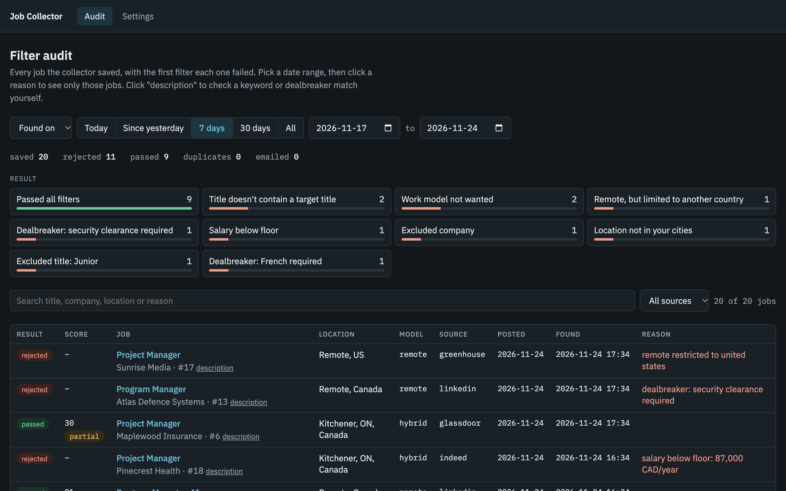
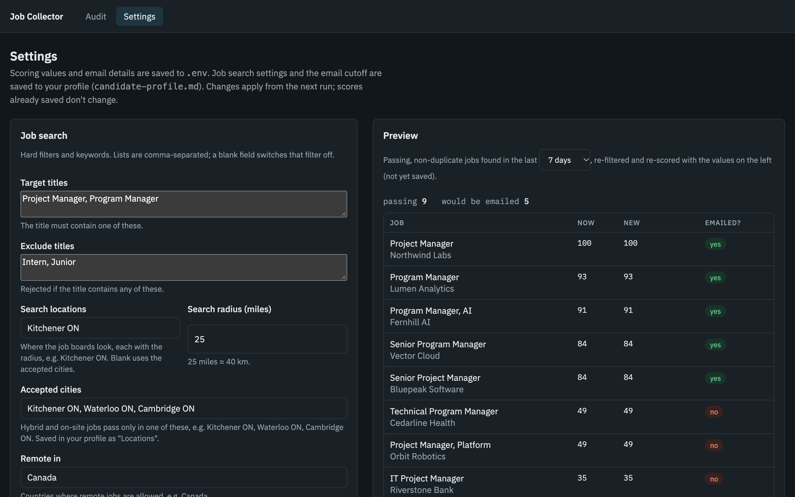

# JobCollector: Self-Hosted Job Search Automation for LinkedIn, Indeed and Glassdoor

**Get the jobs that match you emailed every 2 hours, from LinkedIn, Indeed, Glassdoor, Randstad, Robert Half and company career pages. No login, no AI, no subscription.**

[](https://github.com/talhaimran/JobCollector/actions/workflows/tests.yml)
[](https://github.com/talhaimran/JobCollector/releases/latest)
[](LICENSE)
[](https://www.python.org/)
[](https://www.sqlite.org/)
[](#scheduling-macos-or-windows)
[](#contributing)



## Table of Contents

- [Why use JobCollector?](#why-use-jobcollector)
- [Features](#features)
- [Tech stack](#tech-stack)
- [Quick start](#quick-start)
- [Usage](#usage)
- [Configuration](#configuration)
- [How it works](#how-it-works)
  - [LinkedIn](#linkedin)
  - [Randstad Canada](#randstad-canada)
  - [Robert Half Canada](#robert-half-canada)
  - [Pipeline](#pipeline)
  - [How the pre-score works](#how-the-pre-score-works)
- [Audit and settings page](#audit-and-settings-page)
- [Scheduling (macOS or Windows)](#scheduling-macos-or-windows)
- [Checking the filters](#checking-the-filters)
- [Project layout](#project-layout)
- [Roadmap](#roadmap)
- [Contributing](#contributing)
- [License](#license)

## Why use JobCollector?

Checking LinkedIn, Indeed, Glassdoor and a dozen company career pages every day takes time, and the built-in job alerts are noisy: they ignore your salary floor, mix in titles you don't want and send the same reposted job three times.

JobCollector is a **self-hosted job scraper and job alert tool** written in Python. Every 2 hours it collects postings from the last 24 hours, removes duplicates across sites, applies your hard filters (title, location, remote / hybrid / on-site, salary, dealbreakers), gives each job a keyword match score and **emails you only the new jobs worth reading**. Everything is stored in a local SQLite database you own, so you can see why each job was rejected.

It never logs in to any site and uses no AI or paid API. It runs on your own Mac or Windows PC.

## Features

- **Multi-source job aggregation:** LinkedIn (its own rate-limited client), Indeed and Glassdoor via [JobSpy](https://github.com/speedyapply/JobSpy), Randstad and Robert Half Canada, and the public **Greenhouse, Lever and Ashby** job board feeds of the companies you name.
- **Cross-site de-duplication:** a company + title + city fingerprint catches the same job on two boards and reposts.
- **Hard filters:** target and excluded titles, accepted cities, "remote in" countries, work model, employment type, CAD salary floor, excluded companies and dealbreaker phrases. Every rejected job keeps its `filter_reason`.
- **Keyword pre-score (0–100):** must-have keyword matches plus title match, with weights you tune from a live preview.
- **Email digest:** HTML + text email over Gmail SMTP with only new, passing, non-duplicate jobs above your cutoff.
- **Local web UI:** an audit page for every saved job and a settings page with a scoring preview, at `http://127.0.0.1:8765`.
- **Scheduler built in:** installs itself into macOS launchd or Windows Task Scheduler.
- **Polite by design:** request budgets, random pauses and back-off, so it doesn't get your IP blocked.

Sites not used: ZipRecruiter and hiring.cafe block scripts outright, and Google for Jobs needs a real browser.

## Tech stack

| Area | Used |
|---|---|
| Language | Python 3.13 (standard library `sqlite3`, `smtplib`, `http.server`) |
| Job boards | [python-jobspy](https://pypi.org/project/python-jobspy/) 1.4.1 (Indeed, Glassdoor), `requests` + `beautifulsoup4` (LinkedIn, Randstad, Robert Half) |
| Company feeds | Greenhouse, Lever and Ashby public JSON APIs |
| Storage | SQLite (`data/jobs.db`) |
| Config | `python-dotenv` (`.env`) + a Markdown profile (`candidate-profile.md`) |
| Scheduling | macOS launchd, Windows Task Scheduler |
| Tests / CI | pytest (no network, HTML/JSON fixtures), GitHub Actions |

## Quick start

**1. Clone and install**

```bash
git clone https://github.com/talhaimran/JobCollector.git
cd JobCollector
python3 -m venv .venv
.venv/bin/pip install -r requirements.txt
cp .env.example .env
```

On Windows use `py -m venv .venv`, `.venv\Scripts\pip` and `.venv\Scripts\python`, and `copy` instead of `cp`.

**2. Add your Gmail details to `.env`** (use a Gmail [app password](https://myaccount.google.com/apppasswords), not your real password). See [Configuration](#configuration).

**3. Describe the jobs you want.** Either open the settings page (`.venv/bin/python -m collector ui`) and fill in *Job search*, or create `candidate-profile.md`:

```markdown
## Job Search Settings
- Target titles: Project Manager, Program Manager
- Exclude titles: Intern, Junior
- Search locations: Kitchener ON
- Search radius (miles): 25
- Locations: Kitchener ON, Waterloo ON, Cambridge ON
- Remote in: Canada
- Work model: Remote, Hybrid
- Employment type: Full-time
- Salary floor (CAD/year): 90000
- Must-have keywords: Agile, Jira, stakeholder management, AI/ML
- Dealbreaker keywords: security clearance required
- Excluded companies: Example Staffing Inc
- Target companies: Example Co | greenhouse | exampleco; Acme | lever | acme
- Email cutoff: 60
```

Target companies are `Name | greenhouse|lever|ashby | board-slug`, separated by `;`. Only the `## Job Search Settings` section is read. A blank setting turns that filter off, and each email lists the filters that were off.

**4. Try it, then schedule it**

```bash
.venv/bin/python -m collector run --dry-run          # everything except sending; prints the email
.venv/bin/python -m collector schedule install       # run every 2 h from now on
```

## Usage

```bash
.venv/bin/python -m collector settings        # show parsed settings
.venv/bin/python -m collector run --dry-run   # everything except sending; prints the email
.venv/bin/python -m collector run             # real run
.venv/bin/python -m collector report          # last 10 runs + which source is fastest
.venv/bin/python -m collector ui              # audit + settings page at http://127.0.0.1:8765
.venv/bin/pytest -q                           # tests (no network)
```

A dry run still saves jobs to the database. Those jobs count as "seen", so a later real run won't email them again.

A run searches each location and "Remote in" country once per search title. Target titles that contain another target title are not searched separately, so "Senior Project Manager" is covered by the "Project Manager" search. Indeed and Glassdoor are searched every run with a 3–8 s pause between queries. When one errors, the collector waits 30 s, then 60 s. After 3 errors in a row it skips that site for the rest of the run.

## Configuration

### Environment variables (`.env`)

| Key | Default | Meaning |
|---|---|---|
| `JOB_FOLDER` | this project folder | folder containing `candidate-profile.md` |
| `EMAIL_FROM`, `EMAIL_TO`, `SMTP_USER` | – | your Gmail address(es) |
| `SMTP_APP_PASSWORD` | – | a Gmail **app password** (Google Account → Security → 2-Step Verification → App passwords) |
| `RESULTS_WANTED` | `25` | results per JobSpy query |
| `SEND_WHEN_EMPTY` | `false` | `true` to get an email even with 0 matches |
| `SEND_PARTIAL_SCORES` | `false` | `true` to also email passing jobs that have no description, tagged *partial score* |
| `LINKEDIN_MIN_HOURS` | `4` | at most one LinkedIn sweep per this many hours |
| `LINKEDIN_REQUEST_BUDGET` | `40` | at most this many LinkedIn requests per sweep |
| `SCHEDULE_PLATFORM` | `mac` | `mac` or `windows`; also on the settings page |
| `SCHEDULE_HOURS` | `2` | how often to run; also on the settings page |
| `SCORE_WEIGHT_KEYWORDS` | `0.7` | keyword share of the pre-score (title gets the rest) |
| `KEYWORD_FULL_MARKS` | `10` | keyword matches that give 100 |
| `TITLE_EXACT_SCORE`, `TITLE_CONTAINED_SCORE` | `100`, `70` | title scores; easiest to set from the settings page |

### Searching vs accepting a location

Two separate settings:

| Profile line | Settings page | Used for |
|---|---|---|
| `Search locations: Kitchener ON` and `Search radius (miles): 25` | Search locations, Search radius | Where LinkedIn, Indeed and Glassdoor look. Each board applies the radius itself, so one city also covers its neighbours. Blank search locations fall back to Locations; a blank radius means 25 miles. |
| `Locations: Kitchener ON, Waterloo ON, Cambridge ON` | Accepted cities | The filter: hybrid and on-site jobs pass only in one of these cities. |

Search wide, accept narrowly. Jobs from inside the radius but outside your accepted cities (Guelph, Brantford, ...) are saved and shown in the audit as "Location not in your cities", so you can spot a city worth adding.

## How it works

### LinkedIn

LinkedIn rate-limits hard (429 "blocked" after a few dozen requests), so it has its own client with a request budget:

- **At most one sweep every 4 hours** (`LINKEDIN_MIN_HOURS`), whatever the run schedule.
- **At most 40 requests per sweep** (`LINKEDIN_REQUEST_BUDGET`): search pages and job pages both count. 5–12 s between requests.
- **Order:** first the job pages of jobs still missing a description, then the searches whose last success is oldest. A search that didn't finish stays oldest, so it goes first next time. Each search covers the time since its own last success plus an hour, so a skipped search misses nothing.
- **Search page, then its job pages:** each search page (10 jobs, newest first) is followed straight away by the job pages (descriptions) of its new jobs that pass the title, location, work model and company checks, then the next page or search. A search stops at the first page with nothing new. Jobs from finished pages are kept even if a later request is blocked.
- **Every search gets at least its first page:** job pages and extra pages stop once the budget left only covers page 1 of each search still to come. Jobs left without a description are saved and fetched first next sweep (up to 3 tries). A search cut short goes first next sweep.
- **The first 429 ends the sweep** with no retries. The next sweep comes after the usual 4 h; there's no growing back-off, since a blocked sweep costs only a request or two.
- Searches use your Search locations and radius, like Indeed and Glassdoor.

In the `runs` table, LinkedIn's count is new jobs only (known ones are dropped before parsing).

### Randstad Canada

randstad.ca's search pages carry their results as JSON, 30 per page. Its robots.txt allows the plain keyword search but not the radius, sort or date filters, so each run:

- searches **Canada-wide once per search title** (`/jobs/q-project-manager/`), paging by relevance up to 5 pages (`RANDSTAD_MAX_PAGES`), 3–8 s between requests;
- keeps jobs dated today or yesterday (postings have a date but no time) and undated ones; Accepted cities and Remote in do the location filtering;
- fetches the job page for the full description, only for new jobs that pass the filters. The search results give just its first few lines.

Any HTTP error (403, 429) ends Randstad for that run and is recorded in the `runs` table. The next run tries again. Most postings are Randstad's own, so the company shows as "Randstad Canada".

### Robert Half Canada

`roberthalf.com/ca/en/jobs/all/<title>` is a keyword search across Canada, newest first, 25 per page. The page carries the results as JSON with everything needed: full description, remote/hybrid/on-site, pay and posting date. So each run:

- searches **once per search title**, usually a single request, paging (`?pagenumber=2`, up to 4 pages) only until it reaches a job dated before yesterday (undated jobs are kept and don't stop the paging);
- fetches no job pages;
- reads the work model from Robert Half's own remote/hybrid/on-site field, and "Contract to Permanent" counts as both contract and full-time.

Like Randstad, it waits 3–8 s between requests, and an HTTP error ends Robert Half for that run only. Robert Half doesn't name its clients, so the company shows as "Robert Half (client not named)".

### Partial scores

A job with no description can't be keyword-scored or checked for dealbreakers, so its score is title-only and it's marked `score_partial`. Glassdoor never gives descriptions, and LinkedIn jobs over the budget wait for theirs. By default these aren't emailed until a description arrives. Turn on `SEND_PARTIAL_SCORES` (or the checkbox on the settings page) to email them straight away, tagged *partial score*, whatever the cutoff.

### Work model

Taken from the source's own field when there is one, then the title and location, then the description. In the description it looks for phrases such as "3 days a week in the office", "2–3 days on-site", "days in office", "Workplace type: Hybrid", "fully remote" and "fully on-site". Five days in the office counts as on-site. Plain "hybrid" next to words like *delivery*, *cloud* or *agile* is ignored.

### Pipeline

1. **Normalize** every posting into one shape (see `collector/normalize.py`).
2. **De-duplicate:** a job already stored with the same `(source, source_job_id)` or URL is skipped. Otherwise the collector builds a fingerprint from company + title + city, with suffixes like Inc and Ltd stripped. If an earlier row (from any source, reposts included) has the same fingerprint, the new row is saved with `duplicate_of` set and is never emailed. Randstad and Robert Half jobs are the exception: those agencies rarely name the client, so two of their jobs with the same title and city would look identical. They're matched by their own job ID only, which means an agency repost under a new ID is emailed again.
3. **Hard filters**, in order. The first failure is saved in `filter_reason`:
   1. excluded company
   2. exclude titles (whole word)
   3. target titles (whole word)
   4. work model and location:
      - Remote jobs pass unless their location names a country outside "Remote in".
      - Hybrid and on-site jobs must match one of your "Locations" (accepted cities).
      - Jobs with an unknown work model must match a location and are flagged in the email.
      - Work models you didn't list (e.g. on-site) fail.
   5. employment type (an unknown type passes)
   6. salary floor: hourly ×2080, daily ×260, weekly ×52 and monthly ×12. Only CAD (or no currency) is checked. Other currencies pass and are flagged in the email.
   7. dealbreaker phrases in the title or description.
4. **Pre-score** (0–100), for jobs that pass.
5. **Save** everything, filtered-out jobs included.
6. **Email** only new, passing, non-duplicate jobs scoring at least "Email cutoff". Jobs without a description wait for one, or are emailed as *partial score* if you turn that on. A LinkedIn job whose description arrives in a later sweep is filtered and scored again then.

### How the pre-score works

```
keywords = min(100, matched_must_have / KEYWORD_FULL_MARKS * 100)     # default 10 matches = 100
title    = 100 if title == a target title
           70  if a target title appears inside the title
           0   otherwise
total    = keywords * 0.70 + title * 0.30
```

Keywords match case-insensitively as whole words or phrases in the title and description, so `AI/ML` and `Monday.com` work. When "Must-have keywords" is blank, total = title score.

**Tuning:** run `python -m collector ui` and open **Settings**. Move the keyword/title slider, the full-marks count, the two title scores or the email cutoff, and the preview re-scores recent passing jobs and shows which would be emailed, before you save. Saving writes the scoring values to `.env` and the cutoff to your profile. Defaults live in `SCORE_DEFAULTS` in `collector/config.py`. Saved changes apply from the next run; scores already in the database don't change.

Note that Glassdoor returns no descriptions (JobSpy 1.4.1), so Glassdoor jobs score on title only and dealbreakers are checked against the title alone.

## Audit and settings page

`.venv/bin/python -m collector ui` serves a page on `http://127.0.0.1:8765`. It listens only on your own computer and rejects requests from other sites. Stop it with Ctrl+C.

- **Audit**: every saved job, filtered by date found or date posted (Today, Since yesterday, 7 days, 30 days, All, or a custom range). Click a rejection reason to list those jobs, and click *description* to read the text the keyword and dealbreaker checks saw. *Recent runs* lists per-source counts and errors.


- **Settings**: the job search settings (titles, locations, work model, salary floor, keywords, excluded companies), pre-score weights, email cutoff, Gmail addresses and app password, and *Send test email*. The app password is never sent back to the page: leave the field blank to keep the saved one. The preview re-runs the filters and scores on saved jobs with your unsaved values.

No profile yet? Fill in *Job search* and save: the page creates `candidate-profile.md` with just a `## Job Search Settings` section. If the profile has no such section, one is added at the end. Target companies and base resume are still edited in the file.

## Scheduling (macOS or Windows)

Pick the computer and the interval on the settings page (or `SCHEDULE_PLATFORM` and `SCHEDULE_HOURS` in `.env`), then install:

```bash
.venv/bin/python -m collector schedule install      # macOS: launchd, runs once now too
.venv/bin/python -m collector schedule status
.venv/bin/python -m collector schedule uninstall
```

On Windows run the same with `.venv\Scripts\python`. That creates a Task Scheduler task called *JobCollector* that runs `windows\run-collector.cmd` every N hours. Installing again after changing the interval replaces the old schedule. If `SCHEDULE_PLATFORM` doesn't match the computer, the command refuses.

Watch the log: `tail -f logs/collector.log` (macOS) or `type logs\collector.log` (Windows).

A lock file (`data/collector.lock`) stops two runs from overlapping on both systems. The OS releases the lock if a run crashes. When the Mac is asleep, launchd runs the missed job once it wakes. Task Scheduler skips runs missed while Windows was off unless you tick *Run task as soon as possible after a scheduled start is missed* in the task's settings.

**macOS privacy:** if the project lives under `~/Documents`, which macOS protects, and `logs/collector.err.log` shows `Operation not permitted`, there are two fixes:
- Give `.venv/bin/python`'s target (for example `/Library/Frameworks/Python.framework/Versions/3.13/bin/python3.13`) Full Disk Access in System Settings → Privacy & Security.
- Or move the project out of `~/Documents`.

## Checking the filters

```bash
sqlite3 data/jobs.db "SELECT filter_reason, COUNT(*) FROM jobs WHERE filter_passed=0 GROUP BY 1 ORDER BY 2 DESC"
sqlite3 data/jobs.db "SELECT title, company, location, work_model, filter_reason FROM jobs WHERE filter_passed=0 ORDER BY id DESC LIMIT 30"
sqlite3 data/jobs.db "SELECT prescore_total, title, company, matched_keywords FROM jobs WHERE filter_passed=1 ORDER BY id DESC LIMIT 30"
```

### Test checklist (definition of done)

1. `collector settings` prints the settings from your profile correctly.
2. `collector run --dry-run` completes and logs job counts per source in `runs`. Any source errors are logged without stopping the run.
3. Running it again right away finds 0 new jobs.
4. A real run sends you one email with correct links, and a run with nothing new sends nothing.
5. `jobs` shows a clear `filter_reason` for every job that was filtered out (see the queries above).
6. The scheduled job (launchd or Task Scheduler) runs on schedule and writes to `logs/`.

## Project layout

```
collector/
  config.py        knobs: weights, delays, sites, results per query
  settings.py      Job Search Settings parser
  sources/         linkedin.py (own client, request budget), jobspy_src.py (Indeed, Glassdoor),
                   randstad.py, roberthalf.py, feeds.py (Greenhouse/Lever/Ashby), shared HTTP retry
  normalize.py     one job shape, work-model detection, phrase matching
  dedupe.py        fingerprints
  filters.py       hard filters
  prescore.py      keyword pre-score
  db.py            SQLite schema, lock
  emailer.py       HTML + text email, Gmail SMTP
  pipeline.py      a run, end to end
  schedule.py      launchd / Task Scheduler install
  webui.py, web/   audit + settings page
  cli.py           run / settings / report / ui / schedule
launchd/           macOS plist template
windows/           run-collector.cmd for Task Scheduler
tests/             pytest suite with offline fixtures
```

## Roadmap

JobCollector is in **Phase 1**: collect, filter, keyword-score and email. Ideas for what comes next:

- [ ] AI scoring of each job against your resume (the profile's `Base resume` is already parsed)
- [ ] Salary filters in currencies other than CAD
- [ ] More company job board feeds (Workday, SmartRecruiters, Recruitee)
- [ ] Linux scheduling (cron / systemd timer)
- [ ] Notifications beyond email (Slack, Telegram, Discord)

Have an idea? [Open an issue](https://github.com/talhaimran/JobCollector/issues).

## Contributing

Bug reports, new job sources and filter improvements are welcome.

1. Fork the repo and create a branch: `git checkout -b my-change`
2. Install and run the tests: `.venv/bin/pytest -q` (they use saved fixtures and never touch the network)
3. Add a test for your change, keep the diff small, and open a pull request.

When adding a source, please respect the site's limits: no logins, a request budget and pauses between requests.

## License

Released under the [MIT License](LICENSE). Copyright (c) 2026 Talha Imran.

This project is for personal job searching. You are responsible for following the terms of service of each site it reads from.
